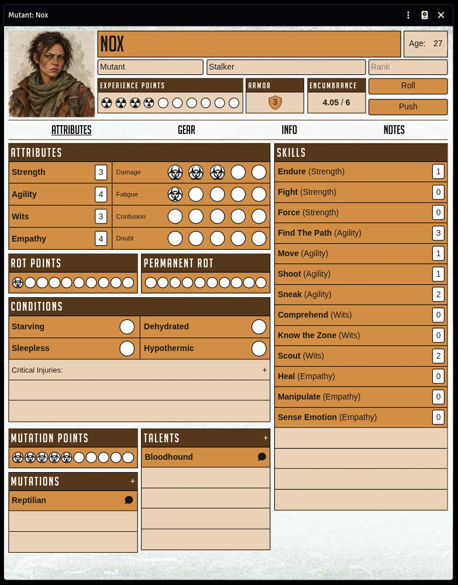
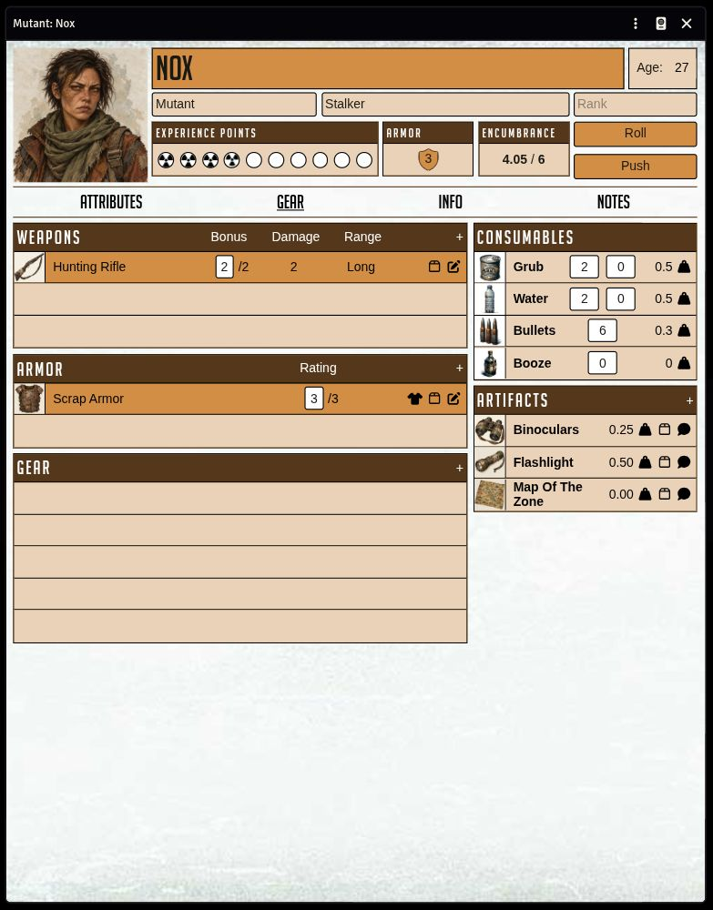
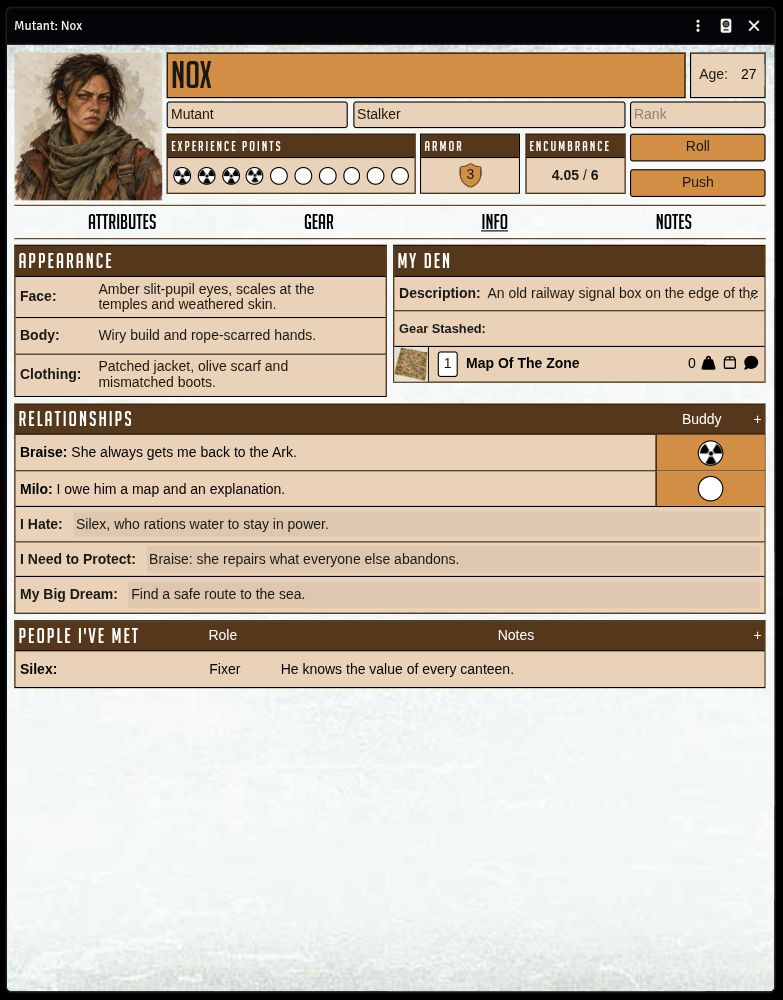

# Mutant Year Zero — Alternative Sheet

An alternative character sheet for Foundry VTT, designed to bring the distinctive look of the **Mutant: Year Zero paper sheet** to the table: familiar colours, bold typography and rows of checkboxes, with dice rolls and inventory management built in.

## Features

- Attributes, skills, trauma, conditions, mutations and talents in one view.
- Equipment, consumables, encumbrance and stash controls.
- Editable appearance and linked character relationships with drag and drop.
- Rich-text notes and a layout that adapts to smaller windows.
- English and French translations.

### Attributes

### Gear

### Info

## Compatibility

Requires **Foundry VTT 14** and the **Mutant Year Zero system 14.0.4+**. Supports mutant characters.

## Installation

1. Copy the module manifest URL from [GitHub Releases](https://github.com/rfulop/myz-alt-sheet/releases) into Foundry's **Install Module** dialog.
2. Enable the module in your world's **Manage Modules** menu.
3. Open a mutant character's sheet configuration and select **Mutant Year Zero — Alternative Sheet**.

## Feedback and credits

An unofficial community module by **[rfulop](https://github.com/rfulop)**. [GPL v3](LICENSE) · [Report a bug](https://github.com/rfulop/myz-alt-sheet/issues).
